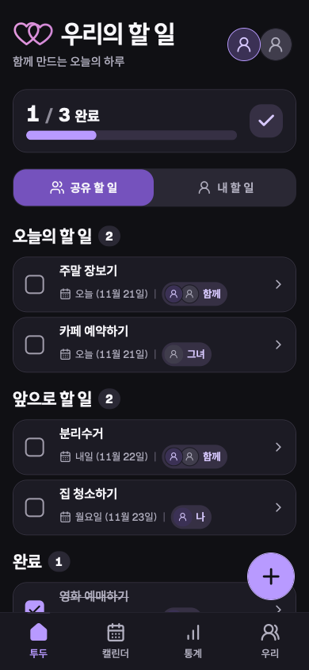
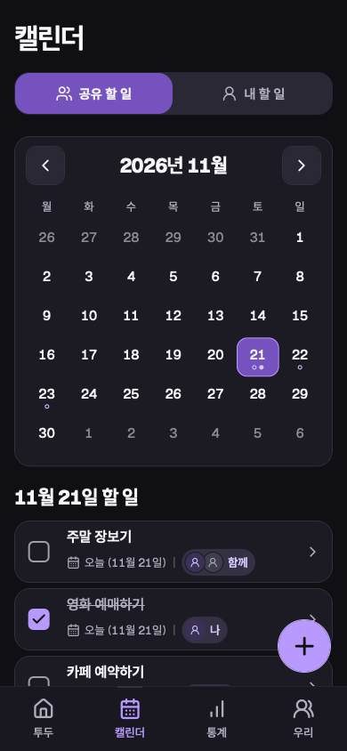
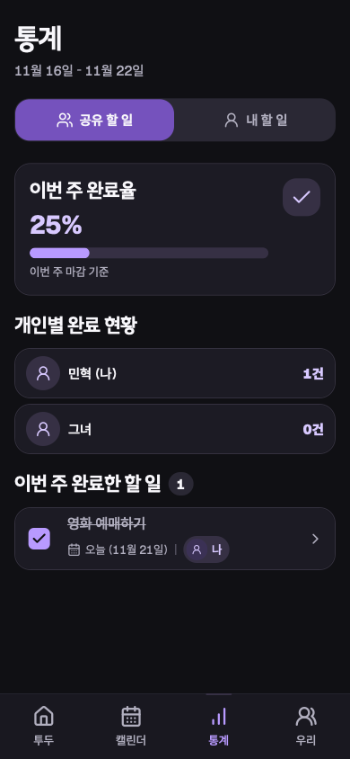
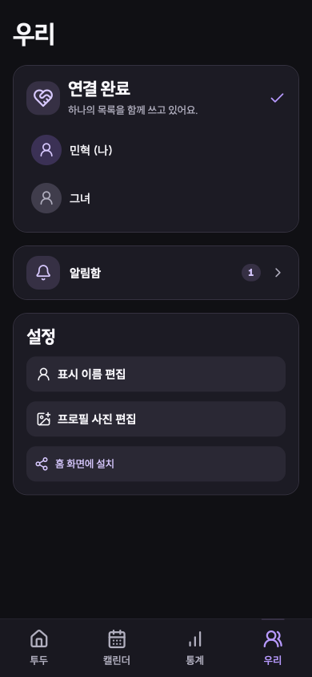
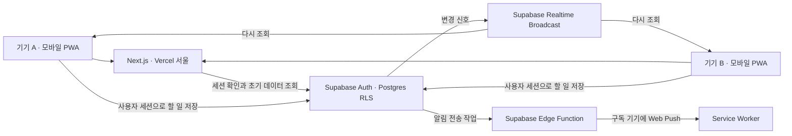

# 우리의 할 일 · Couple Todo

**두 사람이 함께 할 일을 정하고, 각자의 일정도 관리하는 모바일 PWA.**

메신저에 흩어지는 장보기나 예약을 한 목록에 모았습니다. 담당자와 마감일을 정하고, 한 사람이 완료하면 상대의 화면에도 새로고침 없이 반영됩니다.

[운영 앱](https://couple-todo-coral.vercel.app) · [로컬 데모](#로컬-데모) · [설정 및 배포 가이드](docs/setup.md)

## 화면

| 투두 | 캘린더 | 통계 | 우리 |
|:---:|:---:|:---:|:---:|
|  |  |  |  |

Playwright WebKit에서 390 × 844px로 캡처한 데모 화면입니다. 차콜과 라벤더를 바탕으로 한글 제목은 SUITE, 본문은 SUIT, 날짜와 진행률 숫자는 Geist Sans를 사용합니다.

## 주요 기능

- **두 사람 연결** · 이메일 인증번호로 로그인한 뒤 일회용 초대 코드로 하나의 2인 공간을 연결합니다.
- **공유·개인 투두** · 할 일을 추가·편집·삭제하고 담당자와 마감일을 지정합니다. 완료한 항목은 완료 섹션으로 이동하며 다시 열 수 있습니다.
- **캘린더·통계** · 날짜별 할 일, 오늘의 진행률, 이번 주 완료율과 실제로 완료한 사람을 확인합니다.
- **프로필** · 사진을 등록하면 담당자 배지에 표시됩니다. 배지를 누르면 사진을 확대하고, ‘함께’ 배지는 두 사람의 원형 프로필을 살짝 겹쳐 보여줍니다.
- **알림함·Web Push** · 상대의 공유 할 일 추가·완료·담당자 및 마감일 변경·삭제를 알려줍니다. 기기별 푸시, 알림 유형, 서울 시간 기준 방해 금지 시간을 설정할 수 있습니다.
- **홈 화면 설치** · iPhone 홈 화면에서 독립 창으로 실행합니다. 연결이 끊기면 열린 목록을 볼 수 있고, 다시 연결되면 최신 상태를 가져옵니다.

## 구현에서 해결한 문제

| 문제 | 구현 |
| --- | --- |
| 완료 체크가 서버 응답을 기다리면 느리게 느껴짐 | 체크 즉시 UI에 반영하고, 행의 `version`을 비교해 다른 기기의 변경을 덮어쓰지 않도록 했습니다. 저장이 실패하면 화면을 저장된 상태로 되돌리고 오류를 표시합니다. [완료 처리](components/app-provider.tsx#L198) |
| 동기화하면서 두 사람의 개인 목록을 격리해야 함 | 계정과 공유 공간에 분리된 비공개 Realtime Broadcast 채널로 변경 신호만 전송합니다. 각 기기가 RLS를 거쳐 목록을 다시 읽고, 재연결하거나 화면으로 돌아오면 다시 조회합니다. [Realtime 구독](components/use-private-topic.ts) · [RLS와 초대 검증](supabase/migrations/20261121000000_couple_todo.sql) |
| 목록 속 사진은 가볍고, 확대했을 때는 선명해야 함 | 최대 192px 썸네일과 최대 768px 확대용 이미지를 따로 저장합니다. 인증된 요청에만 본인 또는 연결 상대의 사진을 반환하고 브라우저와 CDN 캐시를 막습니다. [사진 처리](lib/profile-photo.ts) · [사진 응답](app/profile-photo/%5Bid%5D/route.ts) |
| 푸시가 실패하거나 방해 금지 시간일 때도 이력이 필요함 | 할 일 변경과 알림함 기록을 DB에서 처리하고, 푸시 전송은 별도 작업 큐에서 재시도합니다. 방해 금지 시간에는 푸시를 생략하고 알림함 기록을 유지합니다. [알림 마이그레이션](supabase/migrations/20261121000001_shared_notifications.sql) · [전송 함수](supabase/functions/dispatch-notifications/index.ts) |

## 아키텍처



| 영역 | 기술 |
| --- | --- |
| 프런트엔드 | Next.js 16 App Router · React 19 · TypeScript · Tailwind CSS 4 |
| 백엔드 | Supabase Auth · PostgreSQL RLS 및 RPC · Realtime · Edge Functions |
| PWA·호스팅 | Web App Manifest · Service Worker · Web Push · Vercel 서울(`icn1`) |
| 검증 | Node.js 테스트 러너 · PGlite · pgTAP · Playwright(Chromium·WebKit) |

## 로컬 데모

Node.js 24와 pnpm 11을 사용합니다.

```sh
git clone https://github.com/Parkminem/couple-todo.git
cd couple-todo
pnpm install --frozen-lockfile
pnpm demo
```

[localhost:3000](http://localhost:3000)에서 로그인이나 Supabase 설정 없이 예시 데이터로 화면을 둘러보고 할 일을 수정할 수 있습니다. 데모에서 바꾼 내용은 메모리에 유지되며 운영 앱은 등록된 계정으로 로그인합니다. [실제 두 계정 연결과 배포 설정](docs/setup.md)

## 테스트

```sh
pnpm lint
pnpm typecheck
pnpm test
pnpm exec playwright install chromium webkit
pnpm test:e2e
pnpm build
pnpm test:e2e:pwa
```

- **로직·DB** · 서울 기준 날짜, 완료 이력, RLS 격리, 초대 코드, 알림 조건과 재시도를 검증합니다.
- **브라우저** · 375·390·402·430px에서 네 화면과 로컬 폰트를 확인합니다. Safe Area, 스크롤, 완료 상태 이동, 프로필 확대와 알림 설정도 검증합니다.
- **PWA** · 설치 메타데이터, 오프라인 안내 화면, 로그인 화면 및 인증이 필요한 문서를 Service Worker 캐시에 보관하지 않는지 확인합니다.
- **Supabase 통합** · 별도의 로컬 환경에서 두 계정의 OTP 로그인, 초대 코드, 양방향 동기화, 개인 목록 격리, 완료 체크 롤백을 검증합니다. [통합 테스트 실행 방법](docs/setup.md#로컬-supabase-통합-테스트)

## 코드 구성

| 경로 | 역할 |
| --- | --- |
| [`app/`](app) | 페이지, 세션을 확인하는 레이아웃, 앱 매니페스트, 프로필 사진 API |
| [`components/`](components) | 화면과 공통 UI, 할 일·동기화·기기 알림 상태 |
| [`lib/`](lib) | 날짜·통계, 이미지 처리, Supabase 클라이언트 |
| [`supabase/`](supabase) | SQL 마이그레이션, RLS 테스트, OTP 템플릿, 푸시 전송 함수 |
| [`public/`](public) · [`tests/`](tests) | Service Worker·폰트·앱 아이콘, 로직·브라우저 테스트 |
